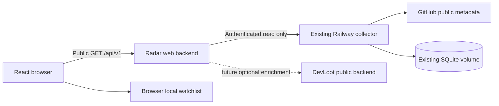

# Backend architecture and data contracts

## Decision

Keep this React application and a small Fastify backend together in `devloot-trends`. Keep ingestion in the existing Railway collector. Initially deploy the new web/backend application as one origin so the browser uses relative `/api/v1/*` URLs. The backend is a read-only adapter with a cache; it is not another collector. No new SQL database or Redis is necessary for the MVP's browser-local watchlist.



This makes the MVP independent of DevLoot login and deployment cycles. It also keeps a small transport boundary that can later move into a NestJS `trends` module without changing browser contracts. Do not create a shared library or plugin framework before a second real consumer exists. The relevant framework baselines are [React's framework guidance](https://react.dev/learn/creating-a-react-app), [Vite](https://vite.dev/guide/), and [Fastify](https://fastify.dev/docs/latest/Guides/Getting-Started/). Vite is deliberately used for compatibility with the existing projects and a small client-first release; server-rendered metadata is a separate, explicit launch task below.

## Alternatives considered

| Option | Benefit | Cost | Decision |
| --- | --- | --- | --- |
| Browser calls collector directly | Few files | Exposes an admin-capable token; no safe public projection | Reject |
| Add all functionality to core immediately | Existing auth/community/database | Couples discovery to wallet/product dependencies and an active refactor | Defer |
| Separate React app + thin Fastify adapter | Reuses existing service, independently deployable, simple local setup | One small web service to operate | MVP choice |
| Separate full NestJS/Postgres application | Rich server state | Duplicates core infrastructure before it is needed | Reject for MVP |
| New collector inside Radar | Easy local ownership | Duplicate API load, fragmented history, unnecessary data migration | Reject |

## Existing analyzer contract, verified from source

| Route | Current behavior | Radar usage |
| --- | --- | --- |
| `GET /healthz` | Public process readiness | Operational check only |
| `GET /api/trends` | Bearer-protected full catalog and collector/archive state | Server-only read and whitelist projection |
| `POST /api/trends/scan` | Requests scan | Never proxy or call from Radar |
| `PUT /api/trends/collector` | Changes pause state | Never expose |
| `PATCH /api/trends/:id` | Shared studio saved/dismissed flags | Never expose or use as public preferences |

There is **no HTTP history endpoint** in the inspected source. The catalog has metrics but not arrays of observations. `TrendStore.history(id, now)` returns only the last 26 hours. Pruning retains observations for 8 days. Therefore a weekly/monthly graph is not already available just because points persist for several days. Do not manufacture a sparkline from `hour`, `sixHours`, `day`, and current stars.

The analyzer chooses tracked repositories with studio saved flags, signal state, recent discovery/priority, score, and recency. Catalog membership is not uniform GitHub coverage. `tracking` means membership in the selected active set, not proof of a recent sample; `checkedAt` must also be evaluated.

Eligibility excludes private, forked, archived, disabled, and missing/custom-license repositories using a concrete SPDX allowlist in `server/trend-score.ts`. Call this “selected public open-source repositories,” not “all of GitHub.” `dismissed` is overloaded: studio dismissal and later ineligibility/unavailability can both set it. MVP conservatively excludes dismissed records. Separating moderation/editorial dismissal from eligibility is a later collector improvement, not something the web adapter can infer.

## Measurements and display rules

The existing `scoreTrend` implementation remains authoritative. For an observation at `latest.at`, a window baseline must occur at or before `latest.at - window`, within `min(20% of window, 30 minutes)`. One-hour tolerance is 12 minutes. Net change is latest total minus the observed baseline total; the interval can be slightly longer than its nominal label. UI uses `~1h`, `~6h`, `~24h` and explains the tolerance.

Hourly rate is the hourly net change divided by actual elapsed hours. Acceleration compares that rate with the preceding interval between the six-hour baseline and the one-hour baseline. The earlier rate is clamped to ≥0 and the denominator is floored to one star/hour. It is a relative pace ratio, not a prediction and not a quality score.

Existing signals:

- `emerging`: hourly net change ≥20 and acceleration ≥3; UI label “Breaking out”.
- `growing`: hourly net change ≥5 when not emerging; UI label “Growing”.
- `watching`: other cases with a usable hour; UI label “Steady” for clarity, with negative changes still displayed accurately.
- `new`: no usable hourly baseline; UI label “Building baseline”, never “New repository”. Six-hour or daily values may still exist.
- `stale`: latest observation older than two hours; UI label “No recent observation”.

The score is `round(10*log1p(max(0,hourlyRate)) + 8*min(10,max(0,acceleration||0)) + 20*min(1,max(0,hour)/max(100,baselineStars)))`. Preserve it as an internal sorting input; do not present it as `92/100`, a probability, health assessment, or return forecast. It is not bounded to 100. Store `scoringVersion: 'collector-v1'` in public response metadata once the full contract is implemented.

The browser must age cached data as wall time advances: a previously fresh item becomes stale when `now - checkedAt > 2h`, even if the original upstream signal was not stale. Ranking eligibility requires `tracking && !stale && selectedMetric !== null`. The adapter should normalize stale metrics to unavailable on fresh fetches; the UI must also remove cached entries from ranked views as they age. Keep total stars as last-observed totals with a timestamp.

## Public API to finish

The starter implements the minimal catalog route. Extend its schema, do not add a second competing response shape. All timestamps below are UTC epoch milliseconds. Null values carry meaning and must be preserved. Public repo IDs remain safe integer numbers for the current upstream; if IDs exceed JavaScript safe integer range in a future contract, migrate explicitly rather than silently rounding.

### GET /api/v1/catalog

```ts
type Catalog = {
  mode: 'live' | 'demo';
  fetchedAt: number;          // when backend obtained this payload
  lastCollectionAt: number;  // last completed upstream run; not each item's timestamp
  scoringVersion: 'collector-v1';
  collection: { state: 'available' | 'delayed'; intervalMinutes: number };
  coverage: { observed: number; rankedHourly: number; measured6h: number; measured24h: number };
  items: Repository[];
};
type Repository = {
  id: number; fullName: string; description: string; language: string | null;
  stars: number; forks: number; license: string; topics: string[];
  createdAt: string; pushedAt: string; checkedAt: number; firstSeen: number;
  tracking: boolean;
  hour: number | null; sixHours: number | null; day: number | null;
  acceleration: number | null; score: number;
  signal: 'emerging' | 'growing' | 'watching' | 'new' | 'stale';
  reason: string;
};
```

Only allowlisted fields leave the adapter. Omit `saved`, `dismissed`, `projectId`, `priorityUntil`, raw diagnostics, auth information, token expiry, query cursors, quota balances, and GH Archive internals. Validation must check safe integer IDs, bounded text/arrays, finite numbers, timestamps, and owner/name segments, excluding `.` and `..` segments. Reject an invalid upstream payload with sanitized 503; do not quietly treat malformed measurement data as empty/zero.

For this bounded catalog, one shared read and local filtering are simpler than many server queries. Add HTTP compression and inspect payload size. If the live compressed catalog grows beyond 500KB or there are >5,000 repositories, measure before changing to backend pagination/search. This is a review trigger, not a speculative implementation requirement now.

Cache the last good catalog for 60 seconds per backend process; coalesce concurrent cache misses. Do not cache error responses or fetch once per repository row. After an upstream failure, retain a last-good snapshot for up to 10 minutes only if returned as `collection.state='delayed'` with original timestamps. After that return 503. A cold-start failure returns 503. Public response cache headers should remain `no-store` initially; the server cache provides rate control without misleading downstream freshness. Logs should record status, duration, counts, and a generic error code, never auth headers or the raw upstream payload.

The browser refreshes every 60 seconds only while visible, supports manual retry, and cancels abandoned requests. Use TanStack Query v5 when implementing multi-page data use, with a 60-second stale time and shared catalog key. Do not add Redux. A router loader is also acceptable if it achieves the same cache, stale, and cancellation behavior; select one, not both. The fixed plan defaults to TanStack Query.

### GET /api/v1/repos/:owner/:name

Resolve case-insensitively from the validated public catalog, using separate encoded path segments and excluding dot segments. Return `{repository, canonicalPath}` or 404. Do not fetch GitHub for arbitrary names and do not call scan. This endpoint supports direct page loads and server-generated metadata. A repo absent from the current public catalog must not remain publicly available just because it was once cached in the browser.

### GET /api/v1/repos/:id/history?window=24h|7d

First verify the numeric ID is currently in the public catalog. The authorized seven-day follow-up supports `24h` and `7d`; any other window yields 400. Return:

```ts
type History = {
  repositoryId: number;
  window: '24h' | '7d';
  fetchedAt: number;
  points: { at: number; stars: number; forks: number }[];
  availability: 'available' | 'insufficient' | 'unavailable';
};
```

`available`: ≥2 valid points; `insufficient`: 0–1 valid points from a successful upstream history read; `unavailable`: capability not deployed or upstream failed. For a temporary history failure return 503 and let the page keep its overview. A capability absence may return 501 with a stable `HISTORY_NOT_AVAILABLE` code during internal preview; the production launch gate requires the endpoint to exist. Never mask an authentication failure as “insufficient history.”

Sort points ascending, reject duplicate/conflicting timestamps, nonfinite/negative totals, and invalid IDs. Keep at most 200 returned points for 24h and 2,000 for 7d; normal 15-minute sampling needs approximately 97 points over a day. If more samples exist, keep first/last and deterministic buckets without summing cumulative totals. Do not fit a synthetic curve. Coalesce/cache history reads by repo ID and window for 60 seconds with a small bound of 200 cached histories and least-recently-used eviction; this cache has a real bounded-memory consumer.

### GET /api/v1/history?ids=1,2

The November 10 follow-up adds read-only list previews. Validate 1–25 distinct positive safe IDs, read current public membership once, and return per-ID `{repositoryId, history, availability}` entries. Missing public IDs never trigger an upstream request. Read at most four histories concurrently; request only `24h` and reuse the existing per-ID/window cache and coalescing. Individual failures return unavailable entries, never fabricated points. The browser requests visible rows, shares successful results with detail, and does not load Recharts for previews. History failures are suppressed per ID for 60 seconds in a bounded 200-entry map to avoid repeatedly hitting an unavailable endpoint. They remain failures, not successful cached observations.

Browser-local votes have no server write route or shared total. Explicit demo mode serves authored fictional observations; live mode never uses them.

## Required collector addition for real charts

This is a narrowly scoped change in `devloot-instagram-videos`, **not implemented by the current planning task**. The implementing task should prepare a separate diff and local tests; deploying it to Railway is a release operation.

1. Add authenticated `GET /api/trends/:id/history?window=24h` inside the existing bearer-protected route scope. Validate positive safe integer ID and the fixed window. Existing studio API routes retain their behavior.
2. Extend `TrendBackend` with a history read and implement it using `TrendStore.history`. Return actual stored points, filtered to the requested 24h with one pre-boundary point if necessary for continuity; label that point's true time. Keep this bounded to the specified window. A simpler strict 24h filter is acceptable and is the default; never interpolate a boundary value.
3. A missing or dismissed repo returns 404. Because eligibility can change, validate against the current repository record each time; do not serve history from an orphaned snapshot ID.
4. Keep the same bearer authentication and no-store policy. The public Radar adapter strips any private fields. No migration or volume reset is required for this read endpoint.
5. Add route tests for 401, existing repo, missing repo, dismissed repo, invalid window/ID, and exact stored points. Add remote-backend support only where an actual consumer uses that interface; do not introduce generic transports.
6. Do not expand retention, enable GH Archive, change scheduling limits, or alter scoring as a side effect. Those changes need separate evidence and budget decisions.

## Coverage investigation before release

The observed deployment returned six-hour deltas for 647 repos but hourly deltas for only seven. Compare stored timestamps around `latest-1h` with the 12-minute tolerance, measure full scan duration and per-repo revisit intervals, and identify restarts/gaps. Use authenticated read-only diagnostics or a carefully scoped local export; do not dump credentials, production databases, or raw reports into Git. No diagnosis can be established from the single catalog response alone.

If per-repo sampling routinely misses hourly boundaries, fix the real scheduling/budget constraint in the collector and test with representative history. Do not change the UI to call six-hour deltas hourly, broaden tolerances without revising methodology, or hide missing observations. Retain GitHub rate-limit/backoff behavior. A configured capacity of 800 does not guarantee the API budget or run duration supports that many repositories at the advertised cadence.

## DevLoot integration later

Core `Project` is a community that can have multiple `Repository` records; a repository can belong to multiple communities. Match by verified GitHub numeric ID when available (`Repository.githubId`), otherwise canonical normalized GitHub URL. Never equate collector `projectId` with core project ID: that field currently identifies a local video-studio project.

The first worthwhile integration is a read-only public enrichment endpoint returning communities and open funded bounties for a set of repo IDs. It should be batched, cached separately, and optional: a DevLoot outage must not break Radar. Return explicit source IDs, verified URLs, amounts/currencies, and update timestamps. Zero matches means omit the contribution module, not claim there are no GitHub opportunities. Any bounty monetary value uses the DevLoot success token. Do not copy ORM entities or call internal admin APIs from the browser.

Later, if accounts/discussions become necessary, reuse the real core identity and moderation services behind a documented session boundary. Do not reuse cookies across domains by guessing cookie settings, treat same GitHub username as a session, or request repository write access just to browse/save. Read `../devloot-core/docs/features/github-authorization.md` first. Proposed L0–L5 capability bundles are not evidence of implemented or live grants.

Moving the adapter into core later requires only replacing `server/app.ts` routes with a NestJS HTTP controller and keeping transformation/ranking functions framework-independent. At that point apply core's NestJS/hexagonal conventions. Do not build the NestJS module or modify core schemas now.

## Deployment, operations, and indexing

Recommended topology: one new web/backend service plus the already-existing collector. Prepare Node 24 runtime, `npm ci`, `npm run build`, `NODE_ENV=production`, `DATA_MODE=live`, `HOST=0.0.0.0`, provider-supplied `PORT`, and server-only secret injection. `npm start` currently runs the thin TypeScript server through `tsx`, which is deliberately a production dependency. No persistent web-service volume is needed. The collector retains its existing single-replica SQLite volume and deployment configuration. No services were provisioned by this planning task.

Before public launch, implement SPA route handling that never returns HTML for `/api/*` errors or missing assets. For discovery, methodology, and known repo routes, generate escaped route-specific title/description/canonical/Open Graph metadata server-side using the cached public catalog. Keep script embedding safe if initial JSON is serialized; replace `<` or use a safe JSON serializer. Use a configured `PUBLIC_ORIGIN`, not an untrusted Host header, for canonical URLs. Unknown repos return true HTTP 404. A basic `robots.txt` and sitemap include valid canonical routes only, never watchlists or arbitrary query combinations. The starter's `noindex` remains until this is verified. Server metadata is not full body SSR; if organic search becomes the primary acquisition channel, add prerendered/SSR repository bodies in a separate measured iteration.

Suggested operational checks: upstream read success rate, cache age, catalog count, usable-window counts, p95 API response time, and history-read errors. No private diagnostic payloads in public status UI. Set an operational alert only as part of the chosen hosting setup, not by creating a chat automation. Initial review targets: warm cached catalog p95 <300ms within the deployment region, no per-row upstream calls, and no collector traffic scaling linearly with concurrent visitors.

Roll back the new web service independently if its adapter or UI fails. A chart-route deployment should be additive so the studio remains compatible. Retain the previous collector artifact before deployment; never delete/reset its volume to fix application errors. The release checklist is in `BUILD-PLAN.md`.

## Seven-day follow-up (November 10)

The user explicitly included the sibling collector change. `TrendStore.chartHistory(id, now, window)` reads exact timestamps within fixed 24h/7d bounds and excludes future observations. Its original scoring `history(id, now)` remains at 26 hours; retention/pruning remains eight days. The authenticated route validates the requested window and current repo eligibility. `history-7d.patch` is incremental to `history-route.patch`; both changes are already reflected locally, neither deployed.

Repository profiles default to 7d. Selecting 1h/6h/24h requests the 24h response; browser/server query keys include the source window. Preview batches continue using 24h, so a shorter cached response cannot satisfy a weekly request. Unavailable weekly history never becomes demo or silently falls back; visitors can select a shorter view. Chart captions state sample count and actual first/last times, since choosing 7d does not prove seven days of coverage.
